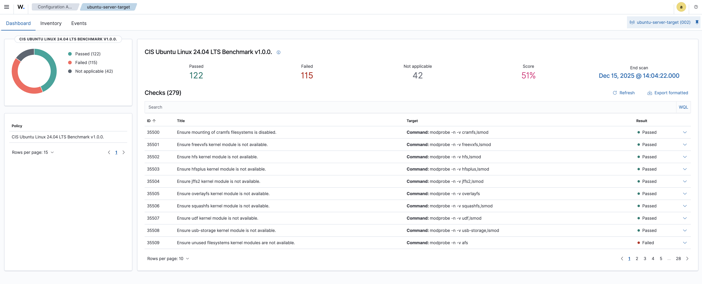
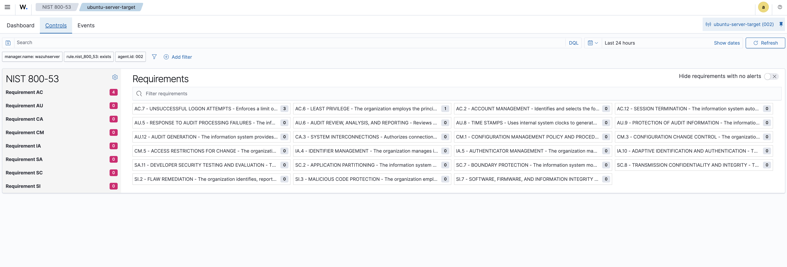
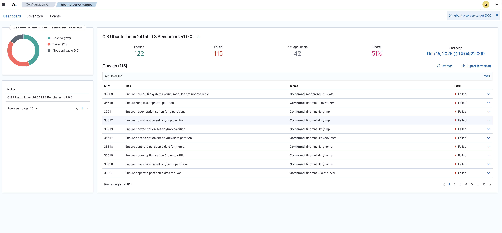

# Wazuh GRC Compliance Lab

## Overview

This project demonstrates a compliance assessment workflow using Wazuh SIEM to evaluate Linux endpoint security against CIS benchmarks and NIST 800-53 controls. The lab includes running Security Configuration Assessment (SCA) scans, analyzing findings by control category, mapping results to compliance frameworks, and producing a professional compliance report.

## Environment

| Component | Details |
|-----------|---------|
| SIEM Platform | Wazuh 4.x |
| Target System | Ubuntu Linux 24.04 LTS Server |
| Benchmark | CIS Ubuntu Linux 24.04 LTS Benchmark v1.0.0 |
| Assessment Type | Security Configuration Assessment (SCA) |

## Assessment Results

| Metric | Value |
|--------|-------|
| Total Checks | 279 |
| Passed | 122 |
| Failed | 115 |
| Not Applicable | 42 |
| Wazuh SCA Benchmark Score | 51% |

The score is the value displayed by Wazuh for this benchmark assessment. It summarizes automated configuration-check results; it is not an organization-wide compliance rating or proof that all requirements of a mapped framework are satisfied.

The totals were verified against the exported CSV: 122 passed, 115 failed, and 42 not applicable, for 279 checks.

### SCA Dashboard


### NIST 800-53 Compliance Dashboard


### Selected Review Areas

I reviewed findings related to:

- **Network configuration:** Firewall configuration and unnecessary network-protocol modules.
- **Authentication and access:** Password-policy components and account settings.
- **Logging infrastructure:** Filesystem layout for log storage.

These are selected review areas, not an exhaustive classification of all failed checks. The CSV preserves the complete assessment results.

### Filtered for Failed


## Work Performed

### 1. Configured SCA Module on Wazuh Agent
Verified and enabled the Wazuh agent configuration (`/var/ossec/etc/ossec.conf`) for Security Configuration Assessment scanning:

```xml
<sca>
    <enabled>yes</enabled>
    <scan_on_start>yes</scan_on_start>
    <interval>12h</interval>
    <skip_nfs>yes</skip_nfs>
</sca>
```

### 2. Executed Compliance Scan and Verified Results
Restarted the Wazuh agent to trigger the SCA scan and confirmed successful execution via log analysis:

```bash
sudo systemctl restart wazuh-agent
sudo cat /var/ossec/logs/ossec.log | grep -i sca
```

Output confirmed:
```
sca: INFO: Loaded policy '/var/ossec/ruleset/sca/cis_ubuntu24-04.yml'
sca: INFO: Starting evaluation of policy...
sca: INFO: Security Configuration Assessment scan finished.
```

### 3. Analyzed Findings in Wazuh Dashboard
Navigated the Wazuh dashboard to review:
- Configuration Assessment module for pass/fail breakdown
- Individual check details including rationale and remediation steps
- NIST 800-53 compliance dashboard showing alerts mapped to control families (AU, AC, SI, CM)

### 4. Exported and Categorized Scan Data
Exported all 279 checks to CSV and filtered findings into categories:
- Network security controls (firewall, kernel modules, network services)
- Authentication controls (SSH, password, cron, sudo)
- Logging controls (auditd, journald, syslog, partitions)

### 5. Reviewed Framework References

I reviewed the framework references supplied in the exported Wazuh assessment data. The CSV's `Compliance` field preserves the mappings associated with individual checks.

These mappings identify potentially relevant requirements for further review. They do not establish that an entire control was assessed or that the system complies with NIST SP 800-53, PCI DSS, HIPAA, SOC 2, or CMMC.

For a defensible finding, I need to keep the following information connected:
- Wazuh check ID and title
- Recorded assessment result
- Associated framework reference, where present
- Supporting system evidence
- Applicability and any limitations

This project documents automated assessment results and a review of their associated references. It does not include independent validation of every mapped control.

### 6. Produced Compliance Report
Generated a professional compliance report documenting:
- Executive summary with assessment scope
- Findings organized by control category
- Framework mapping for each finding
- Prioritized remediation recommendations

📄 **[View Full Compliance Report](reports/CIS_Compliance_Report.pdf)**

## Sample Findings

The following failed checks were verified against the exported assessment data in `data/CIS-Ubuntu Benchmark.csv`. This is a selection of findings, not the complete list of 115 failed checks.

| Wazuh Check ID | Check Title | Recorded Result |
|----------------|-------------|-----------------|
| 35619 | Ensure a single firewall configuration utility is in use. | Failed |
| 35624 | Ensure ufw default deny firewall policy. | Failed |
| 35604 | Ensure dccp kernel module is not available. | Failed |
| 35671 | Ensure libpam-pwquality is installed. | Failed |
| 35677 | Ensure password unlock time is configured. | Failed |
| 35528 | Ensure separate partition exists for /var/log. | Failed |

These are automated assessment results. Each finding requires review of the system configuration, applicability, and operational context before selecting a remediation.

```

## Tools Used

- **Wazuh SIEM** - Open source security monitoring platform
- **Wazuh SCA Module** - Security Configuration Assessment for CIS benchmarks
- **CIS Benchmarks** - Industry-standard security configuration guidelines

## References

- [NIST SP 800-53 Rev 5](https://csrc.nist.gov/publications/detail/sp/800-53/rev-5/final)
- [CIS Benchmarks](https://www.cisecurity.org/cis-benchmarks)
- [Wazuh SCA Documentation](https://documentation.wazuh.com/current/user-manual/capabilities/sec-config-assessment/index.html)

---

*This lab was created as part of a cybersecurity portfolio demonstrating GRC and compliance monitoring capabilities.*
